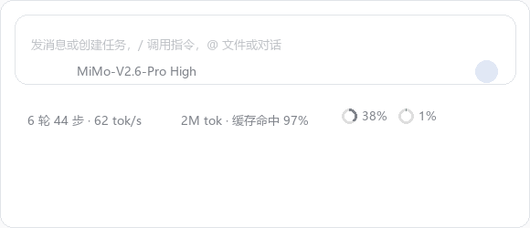
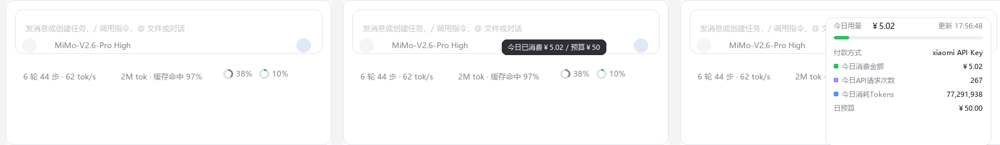
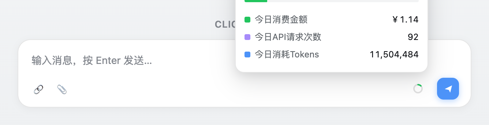

# API Balance Ring · API 余额圆环

**A tiny, real-time Xiaomi MiMo spend meter that lives inside the DeepSeek Harness composer.** Hover the ring for today's spend against your daily budget, click it for the spend, request count and token consumption — priced per model at the official CNY rates, straight from your real session logs.

> 🇨🇳 [中文版 README](README.zh-CN.md)



---

## ✨ Highlights

- **🔴 Today's spend at a glance** — a progress ring sitting immediately to the **right of the built-in context-occupancy ring**, in the same ambient row below the composer, so the two read side by side as `◯6% ◯8%`. Same geometry and theme tokens as that meter. The arc shows **today's spend against a ¥50 daily budget** and shifts green → amber → red as it fills.
- **🖱 Hover** — see `今日已消费￥3.23 / 预算￥50` the moment your cursor touches the ring.
- **📊 Click** — a breakdown panel with **today's spend, API request count and tokens consumed**, the daily budget, and a link to the console page that holds the real account balance. Refreshes every 60 seconds (and on every click).
- **🧮 Priced per model, not per day** — every request is priced with the official **`mimo-v2.6-flash` / `mimo-v2.6-pro` / `mimo-v2.6-pro-ultraspeed`** rate recorded in your session log, so switching models mid-session stays accurate.
- **💴 CNY native** — the official domestic rate card is 元 / 1M tokens, so costs are computed in ¥ directly. No USD→CNY conversion, no exchange-rate drift.
- **⚡ Cache-aware** — prompt-cache hits are billed at their own (much lower) rate, so long agentic sessions price correctly instead of being over-charged at the input rate.
- **🔒 Provider-filtered** — only requests routed through `xiaomi` count. Usage from any other provider never pollutes your MiMo bill.
- **🎨 Native look & feel** — same slot, same geometry, same theme tokens as the shipped context-occupancy ring. Zero dependencies, pure JavaScript, no build step.

## 🖼 Screenshots

The three states — idle, hover, and the click-open panel:



The breakdown panel up close:



## 🧩 How it works

```
┌───────────────────────────── Browser (bundle Client half) ──────────────────────┐
│  conversation.composer.dock slot (ambient row, right of the context ring)       │
│  ┌───────────────────────────────────────────────────────────────────────────┐  │
│  │  BalanceRing component                                                     │  │
│  │   ┌──────────────────────────────────────────┐   fetch('/__dsh-api-…/     │  │
│  │   │ ◯8% + tooltip + panel  ◀────────────────┼─────────────balance')     │  │
│  └───┴──────────────────────────────────────────┘                      │      │  │
└─────────────────────────────────────────────────────────────────────────┼──────┘
                                                                          │ HTTP
┌─────────────────────────────── Host process ────────────────────────────┼──────┐
│  webServer route /__dsh-api-balance-ring/stats   ◀─────────────────────────┘      │
│    → scan every session log (sessionQuery) — no external call                     │
│      · count assistant/message events today where provider == xiaomi              │
│      · sum input + output + cache tokens                                           │
│      · price each request by its model (request/header event), CNY/1M tokens       │
└────────────────────────────────────────────────────────────────────────────────┘
```

## 📦 Installation

### Prerequisites

- **DeepSeek Harness** (the Web GUI) running locally.
- A **Xiaomi MiMo API key** — stored in the harness credential store as `XIAOMI_API_KEY`, which is exactly what `llm-pi-ai`'s `providers.xiaomi.apiKeyEnv` already points at. No credential is needed *by the plugin itself*: it reads only your session logs.

### Steps

The plugin is an installable **bundle**, so it is a real profile plugin rather than a session-local scratch plugin:

1. Clone this repository (or copy the [`bundle/`](bundle/) directory anywhere the harness can read).
2. Ask your agent to install it:
   > install the bundle at `<absolute path to>/bundle` with the plugin manager
3. The agent runs `plugin_manager` `install_bundle` with that absolute package directory as the target. That one call performs the package installation and the bundle selection — do not hand-edit the profile's `package.json` or `cordis.patch.yml`.

The ring appears in the ambient row below the composer, immediately to the right of the built-in context-occupancy ring (`◯6% ◯8%`), within a second.

### It shows up under 全局插件, enabled by default

`bundle/cordis.patch.yml` inserts exactly one plugin row at the **root** scope and never sets `disabled`, so after installation the plugin appears in **设置 → 内置插件 → 全局插件** and is **enabled on every launch by default** — no re-pasting, no re-enabling, and it survives a harness restart.

| | |
| --- | --- |
| Settings page | 设置 → 内置插件 → 全局插件 |
| Row id | `api-balance-ring` |
| Default state | enabled (nothing sets `disabled`) |
| Survives restart | yes |

## 🎯 Usage

| Action | Result |
| --- | --- |
| Hover the ring | Tooltip with today's spend against the budget, e.g. `今日已消费￥3.23 / 预算￥50` |
| Click the ring | Panel: today's cost / requests / tokens, the daily budget, and a link to the console balance |
| Click elsewhere / `Esc` | Panel closes |
| Automatic | Values refresh every 60 s; clicking the ring also refreshes immediately |

The ring arc = `today's spend ÷ daily budget` (full ring at the budget). Color thresholds: **< 60% green**, **< 90% amber**, **≥ 90% red**.

## 🧮 Data & accuracy

| Stat | Source |
| --- | --- |
| Requests / Tokens | Your own **session logs** — every `assistant/message` event carries the real API usage (`inputTokens`, `outputTokens`, `cacheReadTokens`) |
| Cost | Official MiMo **CNY** per-model pricing, applied per request and per token kind |

### Why the ring shows spend, not a remaining balance

MiMo bills an ordinary API key against a prepaid account balance, but the platform publishes **no balance-query API**. That was verified both ways:

- the docs describe token billing and link a *web console* balance page ([定价](https://mimo.mi.com/docs/zh-CN/price/pay-as-you-go), [限流](https://mimo.mi.com/docs/zh-CN/api/guidance/rate-limit)) — no balance endpoint anywhere;
- `GET /v1/models` answers `200` with a valid key, while `/v1/balance`, `/v1/account/balance`, `/v1/dashboard/billing/subscription`, `/v1/credit/grants` and `/v1/user/balance` all answer `404`.

So the ring measures **today's spend against a daily budget**, which is computable from the session logs alone and needs no external call. The panel links to the console page where the real balance lives.

### Pricing table (CNY per 1M tokens — official domestic rates)

| Model | Cache-hit input | Cache-miss input | Output |
| --- | ---: | ---: | ---: |
| `mimo-v2.6-flash` · `mimo-v2.5` | ¥0.02 | ¥1.00 | ¥2.00 |
| `mimo-v2.6-pro` · `mimo-v2.5-pro` | ¥0.025 | ¥3.00 | ¥6.00 |
| `mimo-v2.6-pro-ultraspeed` | ¥0.25 | ¥30.00 | ¥60.00 |

Source: [MiMo API 定价](https://mimo.mi.com/docs/zh-CN/price/pay-as-you-go). Cache **writes** are free for now (`缓存写入：限时免费`) and are therefore not priced. Batch inference is half price, but session logs carry no batch marker, so every request is priced at the real-time rate.

### What counts

- ✅ Only requests with `provider === 'xiaomi'` — those are the ones that spend your MiMo balance.
- ✅ Requests whose model is `mimo-v2.6-flash`, `mimo-v2.6-pro` **or** `mimo-v2.6-pro-ultraspeed` are priced individually, so a mid-session model switch is billed correctly on both sides of the switch.
- ✅ "Today" is your local calendar day (00:00 → now).
- ⚠️ If a request used a model outside the pricing table, the cost shows a `~` prefix — the number is an under-count, never a silent wrong one.
- ⚠️ Batch inference is half price, but session logs carry no batch marker, so batch traffic would be over-counted at the real-time rate.

## ⚙️ Configuration

Everything lives in the `CONFIG` block at the top of each file.

| Constant | File | Default | Meaning |
| --- | --- | --- | --- |
| `dailyBudgetCny` | `bundle/index.js` | `50` | ¥ budget that fills the ring and the bar |
| `providers` | `bundle/index.js` | `['xiaomi']` | providers whose requests count toward the meter |
| `refreshMs` | `bundle/client.js` | `60000` | background refresh interval |
| `warnRatio` / `dangerRatio` | `bundle/client.js` | `0.6` / `0.9` | ring color thresholds (fraction of budget) |
| `tooltipDelayMs` | `bundle/client.js` | `200` | hover delay before the tooltip |
| `balanceConsoleUrl` | `bundle/index.js` | MiMo console | where the panel links for the real balance |
| `PRICING` | `bundle/index.js` | — | per-model rate table in **CNY/1M tokens** (add new models here) |
| `statsPath` | both | `/__dsh-api-balance-ring/stats` | the Host route; the path must match across the halves |

## ❓ FAQ

**Why does the panel show `~` before the cost?** A request ran with a model not in the pricing table (e.g. a brand-new release). Requests and tokens still count; the cost is marked approximate.

**Why is my "today" lower than the platform dashboard?** The plugin reads *your harness's* session logs. Usage from other tools or direct API calls is not in those logs, and small differences in the day boundary can shift the count by a couple of requests.

**Is my API key touched?** No. The plugin never makes an external request — it reads only your local session logs. Your `XIAOMI_API_KEY` is used by the harness's own model adapter and never by this plugin.

**Does it work with `mimo-v2.6-pro`?** Yes — that's exactly why pricing is per request. Switch your model in the composer and the cost readout follows immediately.

## 🖥 Compatibility — macOS & Windows

One pair of files runs on both platforms. Nothing here depends on which shell the harness resolved.

| Concern | How it is handled |
| --- | --- |
| HTTP request | the Host half is an ordinary Node module, so it uses the platform's global `fetch` — identical on macOS and Windows |
| Shelling out | never. There is no `curl`, no `curl.exe`, no `sh -c` vs `powershell -Command` branch to get wrong |
| Client → Host | two namespaced `webServer` routes fetched from the page, the same channel the shipped HMR client uses |
| Session-log aggregation | pure JavaScript over `sessionQuery` — identical on both platforms |
| Plugin installation | `plugin_manager` `install_bundle` — one call, profile-wide, restart-safe |

The earlier *dynamic-plugin* form shelled out to `curl` and had to branch on the platform. Converting the plugin to a **bundle** removed that whole layer: a bundle Host half runs as a normal Node module, so portability is structural rather than a table of special cases.

## 🚧 Known limitations

- MiMo publishes no balance-query API, so the account balance is only visible in the web console (the panel links there).
- Updating an already-installed copy needs a harness restart: replacing an installed package is what loads a fresh JavaScript module generation, so an in-place edit keeps the old module in memory.
- Usage is aggregated from session logs — it reflects the harness, not your whole API account (direct API calls and other tools are not counted).

## 🤝 Contributing

PRs are welcome! Ideas we'd love:

- A config UI (daily budget, thresholds) instead of code constants.

Please keep both halves dependency-free — `bundle/index.js` must import nothing, and `bundle/client.js` must stay a plain script that only uses the `require` seed words.

## 📄 License

[MIT](LICENSE) © EdwinZDZ

*Visual language (ring geometry, panel surface, tooltip plate) is adapted from the [DeepSeek Harness](https://github.com/deepseek-ai/deepseek-harness) built-in context-occupancy meter, MIT licensed.*
